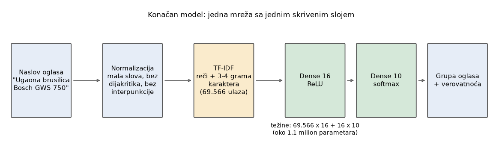

# Ad Title Classifier: klasifikacija oglasa po naslovu (MLP i transformer)

Zadatak: na osnovu naslova oglasa (npr. `Ugaona brusilica Bosch GWS 750`) odrediti jednu od 10 grupa iz tabele `ml_dataset`. Isti podaci i ista podela na trening/validaciju/test (80/10/10) rešeni su na dva načina i upoređeni:

1. **MLP nad TF-IDF vektorima** (`sklearn.neural_network.MLPClassifier`, treniran epohu po epohu),
2. **transformer mreža** (PyTorch, `nn.TransformerEncoder`, trenirana od nule, bez pretreniranih modela).

| model | tačnost na testu | macro F1 | parametara |
|---|---|---|---|
| MLP + TF-IDF (reči + 3-4 grami karaktera) | **99.30%** | 0.9926 | 1.11M |
| transformer (rečnik reči, 4 sloja, d=128) | 97.57% | 0.9748 | 1.07M |

Test skup ima 4151 oglas koji modeli nikad nisu videli. Za ovaj zadatak je bolji jednostavniji MLP; razlog je opisan niže.

## Struktura

| putanja | sadržaj |
|---|---|
| `notebooks/01_podaci.ipynb` | preuzimanje iz MySQL-a, analiza, čišćenje, podela (zajedničko za oba modela) |
| `notebooks/02a_mlp_model.ipynb` | MLP: feature-i i ablacija, kriva učenja, broj neurona, regularizacija, 22 arhitekture, konačan model |
| `notebooks/03a_mlp_evaluacija.ipynb` | MLP: metrike, matrica konfuzije, preprilagođavanje |
| `notebooks/02b_transformer_model.ipynb` | transformer: tokenizacija, arhitektura, normalizacija sa/bez, rečnik, veličina, dropout, konačan model |
| `notebooks/03b_transformer_evaluacija.ipynb` | transformer: metrike, konfuzija, preprilagođavanje, analiza grešaka, poređenje sa MLP-om |
| `src/data.py`, `src/textprep.py` | preuzimanje i priprema podataka, normalizacija teksta (zajedničko) |
| `src/nn.py` | trening MLP-a epohu po epohu sa ranim zaustavljanjem |
| `src/model.py` | rečnik, transformer, petlja za treniranje sa ranim zaustavljanjem |
| `models/mlp_model.joblib`, `models/transformer_model.pt` | već obučeni modeli (oko 35 MB i 4 MB) |
| `docs/` | slika arhitekture MLP-a i PDF sa objašnjenjem transformer mreža (priprema za odbranu) |

Svaki korak u sveskama je objašnjen (šta je urađeno i zašto). Redosled čitanja: 01, zatim 02a/03a (MLP) i 02b/03b (transformer).

## Pokretanje

```bash
python3 -m venv .venv
.venv/bin/pip install -r requirements.txt     # torch je potreban samo za transformer
.venv/bin/jupyter notebook notebooks/
```

Podaci se ne čuvaju u repozitorijumu. Sveska 01 ih preuzima iz baze, a lozinka se zadaje u okruženju (vidi `.env.example`):

```bash
export DB_PASSWORD=...       # lozinka je u tekstu zadatka
```

Vreme izvršavanja na običnom CPU-u: sveska 02a nekoliko sati (ablacija feature-a i 22 arhitekture), 02b oko sat vremena. Obučeni modeli su u `models/`, pa se evaluacione sveske (03a, 03b) mogu pokrenuti bez ponovnog treniranja, kad se podaci preuzmu.

## Podaci

50.000 naslova, 10 grupa. Posle normalizacije (mala slova, ćirilica u latinicu, bez dijakritika, bez interpunkcije) izbačeno je oko 17% duplikata i 9 naslova koji se pojavljuju u više grupa, ostalo je 41.506 oglasa. Podela je stratifikovana i rađena posle deduplikacije, da isti naslov ne bi bio i u treningu i u testu.

## MLP

* **Feature-i:** TF-IDF nad rečima i nad n-gramima karaktera dužine 3-4 (ulaz je 69.566 dimenzija).
* **Arhitektura:** `ulaz -> Dense(16) + ReLU -> Dense(10) + softmax`. Adam (lr 1e-3, batch 128), cross-entropy, L2 = 1e-5, rano zaustavljanje po validacionom gubitku.
* **Veličina mreže:** isprobano je 22 arhitekture (1 sloj sa 8 do 128 neurona, 2 sloja, 3 sloja). Dodatni slojevi nisu pomogli: najbolja jednoslojna `(16,)` ima validacioni gubitak 0.0236, najbolja dvoslojna 0.0245, najbolja troslojna 0.0260. Uzeta je najjednostavnija i ujedno najbolja. Šum između seed-ova je oko 0.0015, pa razlike do 0.002 nisu stvarne.
* **Preprilagođavanje:** tačnost trening/validacija/test je 100% / 99.2% / 99.3%, uz kontrolu sa pomešanim labelama i krivu učenja.



## Transformer

* **Tokenizacija:** jedna reč = jedan token, rečnik samo iz trening skupa (`PAD`, `UNK`, reči sa bar 5 pojavljivanja), naslovi se dopunjavaju na 14 reči.
* **Arhitektura:** embedding reči + embedding pozicije, 4 sloja (self-attention sa 4 glave + feed-forward), prosek vektora preko reči, Dense(10) + softmax. `d_model=128`, dropout 0.3. AdamW (lr 1e-3, batch 128), cross-entropy, rano zaustavljanje.
* **Normalizacija je proverena** (02b, odeljak 2.4): bez normalizacije val gubitak 0.187, samo mala slova 0.161, mala slova bez interpunkcije 0.145, puna normalizacija 0.131. Svaki korak pomaže.
* **Ostali izbori** (na validaciji): veći `min_count` rečnika je bolji (1: 0.181, 2: 0.131, 5: 0.112), dropout pomaže (0: 0.128, 0.3: 0.104), a veličina mreže praktično nije bitna (144k parametara je jednako dobro kao 1.07M).
* **Preprilagođavanje:** tačnost trening/validacija/test je 99.1% / 97.4% / 97.6%.

## Zašto je MLP bolji od transformera

Na test naslovima bez nepoznatih reči transformer ima 99.30%, isto kao MLP. Ali 55% naslova ima bar jednu reč koje nema u rečniku (tačnost 96.15%), a 87% grešaka sadrži takvu reč. TF-IDF sa n-gramima karaktera hvata delove nepoznatih reči i tipfelere, a rečnik reči ih svodi na `UNK`. Ovo je korelacija; drugu tokenizaciju (podreči) nisam probao da bih uzrok potvrdio. Naslovi su i kratki, pa transformer ne može mnogo da iskoristi kontekst.

## Ograničenja

* Zadatak je sam po sebi lak (visoka tačnost već sa vrlo malom mrežom). Greške su većinom jednoreči naslovi bez informacije ili oglasi koji su verovatno pogrešno postavljeni u bazi.
* Kod transformera je svaka konfiguracija trenirana jednom (jedan seed), a `min_count=5` i dropout 0.3 su na kraju ispitanog opsega. Subword tokenizacija nije probana.
* Poređenje sa i bez normalizacije teksta urađeno je samo za transformer.
